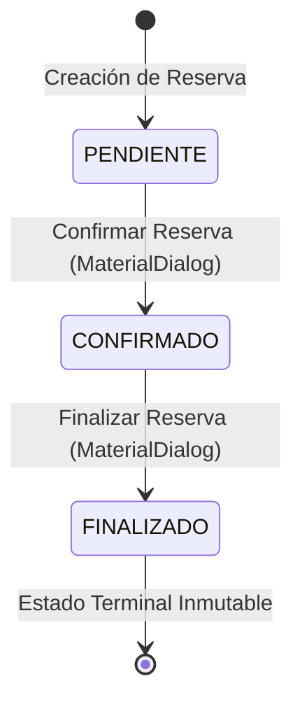

# Manual de Usuario — Aplicativo Móvil Moivo
**Sistema Nativo Android de Gestión y Reserva de Paquetes Turísticos**
*Versión 1.0.0 — Octubre 2026*

---

## 📑 Tabla de Contenidos
1. [Introducción y Propósito del Sistema](#1-introducción-y-propósito-del-sistema)
2. [Requisitos Técnicos e Instalación](#2-requisitos-técnicos-e-instalación)
3. [Control de Acceso e Inicio de Sesión](#3-control-de-acceso-e-inicio-de-sesión)
4. [Estructura y Navegación Principal](#4-estructura-y-navegación-principal)
5. [Módulo de Catálogo y Detalle de Paquetes](#5-módulo-de-catálogo-y-detalle-de-paquetes)
6. [Módulo de Gestión de Clientes](#6-módulo-de-gestión-de-clientes)
7. [Módulo de Creación de Reservas Turísticas](#7-módulo-de-creación-de-reservas-turísticas)
8. [Ciclo de Vida y Transición de Estados de Reserva](#8-ciclo-de-vida-y-transición-de-estados-de-reserva)
9. [Módulo de Geolocalización y Puntos de Encuentro (Google Maps)](#9-módulo-de-geolocalización-y-puntos-de-encuentro-google-maps)
10. [Resiliencia, Persistencia y Tolerancia a Fallos](#10-resiliencia-persistencia-y-tolerancia-a-fallos)
11. [Guía de Solución de Problemas Frecuentes (FAQ)](#11-guía-de-solución-de-problemas-frecuentes-faq)

---

## 1. Introducción y Propósito del Sistema

**Moivo** es una aplicación móvil nativa desarrollada para la plataforma Android, diseñada para optimizar los procesos operativos y comerciales de agencias y operadores de turismo receptivo e independiente.

El aplicativo permite:
- Explorar un catálogo interactivo de paquetes turísticos con información completa de itinerarios, inclusiones, tarifas y puntos geográficos de partida.
- Registrar y administrar una cartera de clientes con validación rigurosa de documentos oficiales (DNI peruano).
- Crear reservas turísticas calculando montos en tiempo real mediante un motor financiero en céntimos que elimina discrepancias de redondeo.
- Monitorear el ciclo de vida completo de cada servicio mediante una máquina de estados segura (`PENDIENTE` → `CONFIRMADO` → `FINALIZADO`).
- Localizar espacialmente los puntos de encuentro utilizando el SDK oficial de **Google Maps** y los servicios de ubicación de Google Play Services.

### Características Clave de Ingeniería
- **Operación Local Garantizada (Offline-First)**: La base de datos local SQLite (administrada mediante Android Room) almacena clientes, reservas y paquetes sin depender de una conexión activa a Internet para registrar servicios.
- **Arquitectura MVVM**: Separación estricta de responsabilidades entre la vista (`UI`), el modelo de vista (`ViewModel`), la lógica pura de negocio (`Domain`) y la capa de persistencia (`Data`).
- **Integridad Referencial y Snapshot Histórico**: Cada reserva congela el precio unitario del paquete al momento de su creación (`unitPriceCents`), protegiendo las finanzas ante variaciones futuras de tarifas.

---

## 2. Requisitos Técnicos e Instalación

### 2.1 Especificaciones del Dispositivo
- **Sistema Operativo**: Android 8.0 (Oreo / Nivel de API 26) como versión mínima requerida. Totalmente optimizado y validado en **Android 15 (Vanilla Ice Cream / Nivel de API 35)**.
- **Procesador**: Arquitecturas `arm64-v8a`, `armeabi-v7a`, `x86` y `x86_64` (emuladores y dispositivos físicos).
- **Memoria RAM**: 2 GB de memoria RAM mínima recomendada (4 GB para experiencia óptima con mapas interactivos).
- **Espacio Libre de Almacenamiento**: Mínimo 50 MB de almacenamiento interno.
- **Servicios de Google**: Google Play Services (versión actualizada recomendada para la visualización del mapa integrado).

### 2.2 Proceso de Instalación del APK (`Moivo-debug.apk`)
1. Localiza el archivo de instalación entregado en la carpeta `delivery/Moivo-debug.apk`.
2. **Instalación en dispositivo físico**:
   - Transfiere el archivo APK a la memoria de tu dispositivo móvil mediante cable USB, correo o mensajería.
   - En Android, abre el administrador de archivos y selecciona `Moivo-debug.apk`.
   - Si el sistema lo solicita, autoriza la opción **Permitir la instalación de aplicaciones de fuentes desconocidas** para tu explorador de archivos.
   - Presiona **Instalar** y, al finalizar, pulsa **Abrir**.
3. **Instalación mediante Android Debug Bridge (ADB)**:
   ```powershell
   adb install -r delivery/Moivo-debug.apk
   ```

### 2.3 Permisos Requeridos del Sistema
| Permiso | Tipo | Justificación de Uso |
|---|---|---|
| `ACCESS_FINE_LOCATION` | Peligroso (Runtime) | Permite determinar la posición GPS exacta del usuario para centrar el mapa y guiarlo hacia el punto de encuentro del tour. |
| `ACCESS_COARSE_LOCATION` | Peligroso (Runtime) | Permite estimación aproximada por red/antenas en caso de que el GPS no tenga visión satelital. |
| `INTERNET` | Normal | Descarga de cartografía en tiempo real para Google Maps SDK. |

> [!NOTE]
> La aplicación **no requiere permisos de ubicación en segundo plano** (*background location*). La solicitud se realiza exclusivamente en primer plano cuando el usuario pulsa deliberadamente el botón "Mostrar mi ubicación". Denegar el permiso no bloquea la creación de clientes ni de reservas.

---

## 3. Control de Acceso e Inicio de Sesión

Al iniciar la aplicación por primera vez, se presenta la pantalla de **Inicio de Sesión** (`LoginActivity`).

### 3.1 Credenciales de Demostración
El aplicativo cuenta con un control de acceso de demostración académico validado en el código fuente (`Validation.java`):

- **Correo electrónico**: `demo@kusitours.pe`
- **Contraseña**: `Kusi2026!`

*(Nota: En caso de requerirse compatibilidad con plantillas previas de documentación, verificar las credenciales asignadas en el módulo de dominio).*

### 3.2 Reglas de Validación en el Login
1. **Validación de Correo**: Se comprueba que el campo no esté vacío y que cumpla con el formato sintáctico general de correo electrónico (`usuario@dominio.ext`). El sistema elimina automáticamente espacios en blanco iniciales o finales y no distingue entre mayúsculas y minúsculas (*case-insensitive*).
2. **Validación de Contraseña**: Campo obligatorio. A diferencia del correo, la contraseña distingue estrictamente entre mayúsculas, minúsculas y caracteres especiales (*case-sensitive*).
3. **Manejo de Errores Visuales**: Si las credenciales no coinciden o los campos están vacíos, los campos de texto muestran un mensaje de error en color rojo (`TextInputLayout`) sin interrumpir la ejecución.

### 3.3 Persistencia de Sesión
Una vez autenticado exitosamente, el sistema almacena una bandera en `SharedPreferences`. Al cerrar y volver a abrir la aplicación, el usuario ingresa de forma directa a la pantalla principal sin requerir ingresar nuevamente sus credenciales. La sesión se mantiene hasta que se seleccione explícitamente la opción **Cerrar sesión** desde el menú superior.

---

## 4. Estructura y Navegación Principal

La pantalla principal (`HomeActivity`) actúa como el centro de control del aplicativo y está dividida en tres componentes esenciales:

1. **Barra de Herramientas Superior (Toolbar)**:
   - Presenta el título de la aplicación (`Moivo`).
   - Menú de tres puntos (Overflow Menu) con la opción **Cerrar sesión**. Al pulsarla, se presenta un diálogo de confirmación que informa que los datos de clientes y reservas quedarán guardados en el dispositivo.
2. **Área de Contenido Dinámico**:
   - Título de sección dinámico que indica la sección activa y la cantidad de elementos presentes (ejemplo: *Paquetes disponibles · 3*, *Clientes registrados · 1*, *Tus reservas · 2*).
   - Lista interactiva desarrollada con `RecyclerView` para un desplazamiento suave y eficiente en memoria.
   - Mensajes de estado vacío (*Empty State*) con recomendaciones de acción cuando una sección no tiene registros creados aún.
3. **Barra de Navegación Inferior (Bottom Navigation)**:
   - **Paquetes**: Acceso al catálogo de experiencias turísticas disponibles.
   - **Clientes**: Directorio de clientes con sus números de documento y datos de contacto.
   - **Reservas**: Historial de reservas emitidas y sus estados operativos.
4. **Botón de Acción Contextual (Floating Button / Botón Inferior)**:
   - En la pestaña de *Clientes*, el botón muestra el texto **Nuevo cliente**.
   - En la pestaña de *Reservas*, el botón muestra el texto **Nueva reserva**.

---

## 5. Módulo de Catálogo y Detalle de Paquetes

### 5.1 Exploración del Catálogo
La pestaña **Paquetes** presenta la oferta turística precargada en la base de datos local:

| Destino | Nombre del Paquete | Duración y Horario | Tarifa por Persona | Punto de Encuentro Oficial |
|---|---|---|---|---|
| **CUSCO** | Cusco Esencial | 1 día · 08:00 a 17:00 | **S/ 180.00** | Plaza de Armas de Cusco, junto a la fuente central |
| **ICA** | Paracas y Huacachina | 1 día · 06:00 a 20:00 | **S/ 240.00** | Plaza de Armas de Ica, frente a la municipalidad |
| **LIMA** | Lima Histórica | Medio día · 09:00 a 13:00 | **S/ 95.00** | Plaza San Martín, monumento central |

### 5.2 Consulta del Detalle del Paquete (`PackageDetailActivity`)
Al pulsar sobre cualquiera de las tarjetas del catálogo, se abre la vista detallada con:
- Fotografía de cabecera en alta definición del destino seleccionado.
- Título del tour, destino geográfico y duración del itinerario.
- Precio por pasajero claramente destacado en moneda nacional (PEN / S/).
- **Descripción detallada**: Resumen de la experiencia cultural o de aventura y recomendaciones de indumentaria y protección solar.
- **Inclusiones y Exclusiones**: Detalle transparente de lo que incluye el servicio (guía certificado, entradas oficiales, movilidad local) y lo que no incluye (almuerzos, alojamiento o actividades facultativas).
- **Punto de Encuentro**: Dirección de referencia para el abordaje.
- **Botón "Ver en el mapa"**: Abre la pantalla de geolocalización centrada en el punto de partida.
- **Botón "Reservar este paquete"**: Abre directamente el formulario de reservas con el paquete precargado.

---

## 6. Módulo de Gestión de Clientes

### 6.1 Registro de un Nuevo Cliente (`ClientFormActivity`)
Para dar de alta a un pasajero o contratante:
1. Dirígete a la pestaña **Clientes** y presiona **Nuevo cliente** (o presiona "+ Nuevo" desde el formulario de reservas).
2. Completa los cuatro campos obligatorios del formulario:
   - **Nombre completo**: Nombre y apellidos del pasajero (mínimo 3 caracteres, máximo 80 caracteres).
   - **Documento (DNI)**: Número de documento nacional de identidad peruano. Debe contener **exactamente 8 dígitos numéricos**. El sistema rechaza letras, símbolos y longitudes distintas.
   - **Correo electrónico**: Dirección de contacto para el envío de información.
   - **Teléfono móvil**: Número celular de **9 dígitos numéricos** (iniciado típicamente en 9).
3. Presiona **Guardar cliente**.
4. El sistema valida los datos en la capa de dominio. Si el DNI ya fue registrado previamente por otro cliente, el sistema aborta la inserción y notifica que el documento ya existe, preservando la integridad de los registros existentes.

### 6.2 Consulta de Ficha Rápida del Cliente
Al pulsar sobre cualquier cliente listado en la pestaña *Clientes*:
- Se despliega un diálogo emergente (*MaterialAlertDialog*) con su DNI, correo y teléfono.
- Presenta el botón **Crear reserva**, el cual abre el formulario de reservas precargando automáticamente a dicho cliente como titular.

---

## 7. Módulo de Creación de Reservas Turísticas

### 7.1 Pasos para Registrar una Reserva (`ReservationFormActivity`)
1. Accede mediante el botón **Nueva reserva** en la pestaña de reservas, o desde el detalle de cualquier paquete.
2. **Selección del Cliente**:
   - Despliega la lista de clientes registrados y selecciona el titular.
   - Si el cliente aún no existe, presiona el botón **+ Nuevo cliente**. Al guardarlo, volverás a la reserva con el cliente recién creado seleccionado de forma automática.
3. **Selección del Paquete Turístico**:
   - Selecciona el tour deseado. El sistema mostrará el nombre y la tarifa individual.
4. **Selección de la Fecha del Viaje**:
   - Presiona sobre el campo **Fecha de viaje**.
   - Se abrirá el calendario nativo (*DatePickerDialog*). El sistema restringe la selección impidiendo marcar fechas pasadas (`minDate = hoy`).
5. **Cantidad de Personas**:
   - Ingresa el número de pasajeros. El sistema acepta cantidades entre **1 y 30 personas**.
6. **Cálculo Automático en Tiempo Real**:
   - Conforme se tipea la cantidad o se cambia de paquete, la sección de total se recalcula instantáneamente sin demoras ni necesidad de pulsar botones adicionales:
     $$	ext{Total} = 	ext{Tarifa Unitario} 	imes 	ext{Número de Pasajeros}$$
7. **Guardar la Reserva**:
   - Presiona **Guardar reserva**.
   - El botón pasa a estado inactivo ("Guardando…") durante la transacción para evitar registros duplicados por toques repetidos.
   - Al confirmarse el guardado, el sistema redirige automáticamente a la pestaña de **Reservas**, mostrando la nueva reserva en estado **PENDIENTE**.

---

## 8. Ciclo de Vida y Transición de Estados de Reserva

Cada reserva turística sigue un flujo unidireccional y estrictamente regulado para garantizar que ningún servicio se salte etapas operativas:



### 8.1 Descripción de Estados
1. **`PENDIENTE`**:
   - Estado por defecto al crear la reserva. Indica que la solicitud fue registrada localmente y está a la espera de validación de disponibilidad o asignación de guía.
   - En la vista de detalle de la reserva (`ReservationDetailActivity`), se habilita el botón **Confirmar reserva**.
2. **`CONFIRMADO`**:
   - Se alcanza tras presionar "Confirmar reserva" y aceptar el diálogo de confirmación.
   - Representa que los cupos están asegurados y el tour está listo para su ejecución.
   - En la vista de detalle, se habilita el botón **Finalizar reserva**.
3. **`FINALIZADO`**:
   - Se alcanza tras presionar "Finalizar reserva" y aceptar el diálogo de confirmación.
   - Representa que la excursión ha concluido satisfactoriamente.
   - **Inmutabilidad**: Al llegar a este estado, se ocultan los botones de avance. La reserva queda como registro histórico inalterable.

### 8.2 Información Consignada en el Detalle de la Reserva
- Identificador correlativo oficial (ejemplo: `#1`).
- Estado actual destacado en tipografía de alto contraste.
- Datos completos del cliente (Nombre, DNI, correo y teléfono).
- Datos del tour contratado (Nombre, destino, duración e inclusiones).
- Fecha programada del viaje y cantidad de personas.
- Desglose financiero: Tarifa unitaria congelada y Monto total en Soles (S/).
- Punto de encuentro oficial y fecha/hora exacta en la que se creó el registro (`dd/MM/yyyy HH:mm`).

---

## 9. Módulo de Geolocalización y Puntos de Encuentro (Google Maps)

Al pulsar el botón **Ver en el mapa** o **Ver punto de encuentro** desde el detalle de un paquete o reserva, se inicia la actividad `MapActivity`.

### 9.1 Mapa Integrado y Marcador Oficial
- La pantalla integra un fragmento de Google Maps (`SupportMapFragment`).
- Se coloca un marcador oficial de color rojo en las coordenadas exactas de encuentro (ejemplo: *-13.5164, -71.9785* en la Plaza de Armas del Cusco).
- El marcador presenta una ventana de información (*InfoWindow*) con el nombre del tour y la dirección detallada.

### 9.2 Controles de Navegación y Ubicación del Usuario
- **Botón "Centrar en el encuentro"**: Realiza una animación suave de cámara (*animateCamera*) con nivel de zoom 16f directamente hacia el marcador de salida.
- **Botón "Mostrar mi ubicación"**:
  - Solicita los permisos `ACCESS_FINE_LOCATION` y `ACCESS_COARSE_LOCATION`.
  - **Si el usuario concede el permiso**: Se obtiene la última ubicación del proveedor de Google Play Services con alta precisión (`Priority.PRIORITY_HIGH_ACCURACY`), se añade un marcador azul con la posición actual y se muestra la precisión en metros.
  - **Si el usuario deniega el permiso**: La aplicación muestra un mensaje amigable indicando que la denegación no afecta la reserva ni la visualización del punto de encuentro.
  - **Si el usuario selecciona "No volver a preguntar" (Denegación Permanente)**: La aplicación despliega un diálogo explicativo con un botón directo **Abrir ajustes** que redirige a la pantalla de configuración de la app en Android para permitir habilitarlo cuando el usuario lo desee.
- **Botón "Abrir en Google Maps" (Fallback Externo)**:
  - Si el dispositivo no cuenta con una API Key de Maps configurada o no tiene instalados los Servicios de Google Play, este botón abre un enlace directo (`geo:` o `https://www.google.com/maps/search/?api=1&query=lat,lng`) en la aplicación externa de Google Maps o en el navegador web del sistema.

---

## 10. Resiliencia, Persistencia y Tolerancia a Fallos

Moivo fue diseñado para resistir las condiciones adversas más habituales en entornos móviles:

### 10.1 Manejo de Rotación de Pantalla
- Al rotar el dispositivo entre orientación vertical y horizontal, Android destruye y recrea la Activity.
- Mediante el mecanismo `onSaveInstanceState`, los formularios de cliente y de reserva conservan intactos los valores tipeados, la fecha seleccionada y los IDs de paquetes y clientes, evitando que el usuario deba reingresar sus datos.

### 10.2 Supervivencia ante Cierre Forzado del Proceso (*Cold Boot*)
- Si el sistema operativo Android finaliza el proceso por falta de memoria (`am force-stop pe.edu.moivo`), o si el usuario reinicia su equipo celular:
- La base de datos SQLite con Room almacena todas las transacciones de manera permanente en disco. Al reabrir el aplicativo, todos los clientes registrados y el estado de las reservas (incluso en estado `FINALIZADO`) se recuperan de inmediato.

### 10.3 Concurrencia Fuera del Hilo de Interfaz
- Ninguna operación de lectura o escritura en la base de datos se ejecuta en el hilo principal (`UI Thread`).
- El componente `TaskViewModel` delega las escrituras a un `ExecutorService` asíncrono, garantizando que la interfaz no sufra congelamientos (*ANR - Application Not Responding*).

---

## 11. Guía de Solución de Problemas Frecuentes (FAQ)

| Síntoma o Mensaje | Causa Posible | Solución Paso a Paso |
|---|---|---|
| **"Credenciales incorrectas" en el Login** | Se ingresó un correo o contraseña que no coincide con las credenciales demo. | Asegúrate de ingresar exactamente `demo@kusitours.pe` en minúsculas y `Kusi2026!` respetando mayúsculas y signos de exclamación. |
| **"El DNI debe contener 8 dígitos"** | Se ingresó un número de documento incompleto o con caracteres alfanuméricos. | Escribe exactamente los 8 dígitos numéricos de tu DNI peruano sin guiones ni espacios. |
| **No se guarda el cliente y no avanza** | El DNI ya está registrado por otro cliente en el sistema. | El DNI es un identificador único en Room. Consulta la lista de clientes o utiliza un DNI que no haya sido registrado previamente. |
| **"La fecha no puede estar en el pasado"** | Se intentó seleccionar una fecha anterior al día de hoy. | Abre el selector de fecha y escoge el día actual o una fecha futura. |
| **El mapa integrado se muestra en blanco o con cuadrícula** | No se configuró una API Key de Google Maps en `local.properties` o no hay conexión a Internet. | No te preocupes: puedes pulsar el botón **Abrir en Google Maps** para consultar el punto de encuentro en la app oficial de Google Maps o en el navegador. Para compilar con mapa propio, añade `MAPS_API_KEY=tu_clave` en `local.properties` y recompila. |
| **"Permiso de ubicación desactivado"** | Se denegó permanentemente el permiso de GPS. | Presiona el botón **Abrir ajustes** en el diálogo modal y activa el permiso de "Ubicación" para Moivo en los Ajustes de Android. |
| **¿Se borran mis clientes al cerrar sesión?** | Dudas sobre la retención de datos. | **No.** Cerrar sesión únicamente limpia la bandera de autenticación en SharedPreferences. Todos los clientes, paquetes y reservas quedan guardados de forma segura en la base de datos local del teléfono. |

---
*Manual elaborado por el equipo de desarrollo de Moivo. Octubre 2026.*
